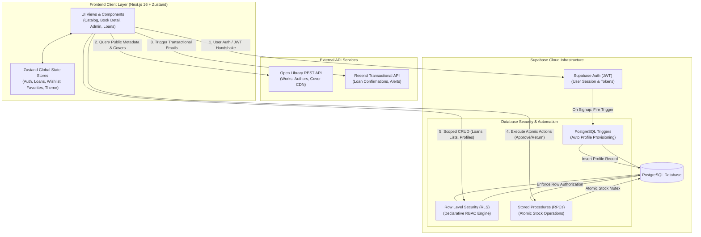
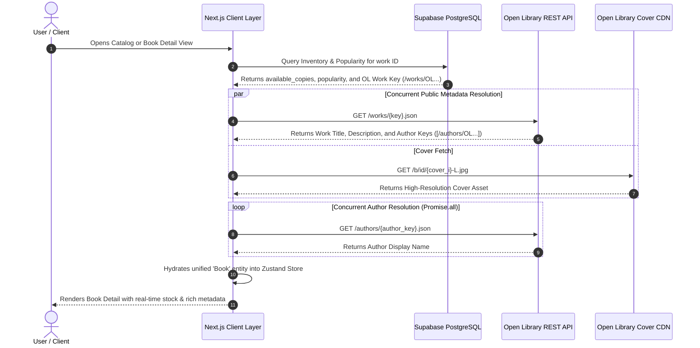
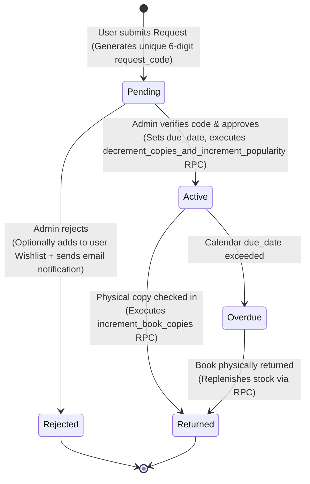
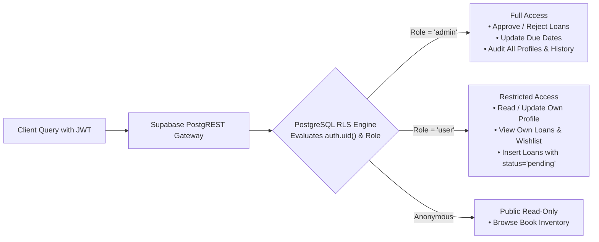

# MyLibrary — Modern Library & Physical Loan Management Platform


A production-ready Single Page Application (SPA) designed for full-lifecycle physical book cataloging, reservation, and loan administration. Built with **Next.js (App Router)**, **Supabase**, and the **Open Library API**, focusing on editorial elegance, magazine-like typography, and enterprise security via PostgreSQL Row-Level Security (RLS) and atomic RPC transactions.

---

## System Architecture & Interconnection

The platform integrates a reactive client layer, public metadata providers, transactional messaging, and an enterprise PostgreSQL database:



---

## How It Works: Technical Workflows

### 1. Composite Data Fetching & Concurrent Author Resolution

To avoid storing millions of public bibliographic records locally while maintaining sub-second query performance, MyLibrary uses a **Composite Synchronization Pattern**. Supabase stores volatile inventory data (`available_copies`, `popularity`, loan status) alongside foreign Open Library keys, while public metadata is fetched and merged concurrently in the client:



---

### 2. Physical Loan State Machine & Atomic Concurrency

Physical library copies are finite resources susceptible to race conditions. The loan request flow is controlled via a deterministic state machine executed through atomic PostgreSQL RPC stored procedures:



---

### 3. Database Security & Role-Based Access Control (RBAC)

Authorization is enforced at the database kernel level via PostgreSQL Row-Level Security (RLS), preventing client spoofing or unauthorized API manipulation:



---

## Technical Decisions: Why This Stack?

### 1. Why Next.js 16 (App Router) + Turbopack?
- **Hybrid Architecture (SSR/SSG + Client Islands)**: Critical for a public book platform. Initial catalog shells and metadata render on the server for instant First Contentful Paint (FCP) and rich OpenGraph/SEO indexing, while interactive components (search filters, confirmation modals, theme toggling) hydrate seamlessly.
- **Turbopack Compiler**: Sub-second Hot Module Replacement (HMR) and ultra-fast production builds, handling modern TypeScript and PostCSS natively.
- **Next Image Optimization**: Automatic AVIF/WebP transcoding, responsive `srcSet` generation, and layout-shift prevention for external covers served from Open Library.

### 2. Why Supabase (PostgreSQL + RLS + RPCs)?
- **Enterprise Security at the Database Layer**: Instead of maintaining fragile middleware or duplicate validation layers in Node/Express, Supabase allows defining declarative **Row-Level Security (RLS)** policies directly in PostgreSQL. Even if a client inspects network requests or attempts manual API calls, unauthorized rows are filtered by the PostgreSQL engine itself.
- **Atomic Concurrency with Stored Procedures (RPCs)**: Physical inventory cannot afford race conditions (e.g., two users borrowing the last remaining copy simultaneously). By offloading stock mutations to PostgreSQL RPC functions (`decrement_copies_and_increment_popularity`), updates execute inside an atomic database transaction with strict mutex guarantees (`check (available_copies >= 0)`).
- **PostgreSQL Triggers**: Automatic profile provisioning (`handle_new_user`) ensures user metadata, roles (`user` vs `admin`), and timestamps are in sync whenever a new account signs up via Supabase Auth.

### 3. Why Open Library API + Composite Data Fetching?
- **Zero Scraping & Massive Bibliographic Scope**: Direct programmatic access to over 30 million public domain and published works, authors, and cover scans without incurring gigabytes of static storage or ongoing maintenance costs.
- **Decoupled Architecture**: By storing only lightweight references (Open Library Work Keys) locally, Supabase remains lean, fast, and focused on operational data (physical loan history, user lists, real-time stock), while static public metadata is fetched on demand.

### 4. Why Zustand over Redux Toolkit or React Context?
- **Zero Boilerplate & Ultra-Small Footprint**: At less than 1.5 KB, Zustand avoids the complex actions, reducers, and thunk overhead of Redux while providing identical predictability.
- **Eliminating Re-render Cascades**: Unlike the standard React Context API—which triggers re-renders across the entire component subtree whenever any context value changes—Zustand uses atomic selector subscriptions (`useAuthStore(state => state.user)`), ensuring only components consuming the changed slice re-render.
- **Instant Client-Side Cache**: Wishlist, Favorites, and Loan items reflect immediately in the UI with zero latency.

### 5. Why Resend for Transactional Email?
- **High Deliverability & Modern Developer Experience**: Unlike legacy SMTP servers or complex AWS SES configurations, Resend offers first-class TypeScript support and modern REST endpoints.
- **Automated Lifecycle Notifications**: Seamlessly sends security login alerts, loan request confirmations, due-date reminders, and restock notifications when wishlist items become available.

### 6. Why CSS Modules with Custom Design Tokens?
- **Scoped Elegance without Class Collisions**: Provides complete CSS expressiveness (custom CSS variables, `color-mix()`, complex typography, keyframe animations) while guaranteeing zero namespace collisions across components.
- **Persistent Theming**: CSS variables defined in `:root` and `[data-theme="dark"]` enable smooth, flicker-free light and dark mode switching with instant persistence.

---

## Key Features

| Domain | Highlights | Status |
| :--- | :--- | :--- |
| **Catalog & Discovery** | Multi-threaded composite search across Open Library catalog, concurrent author resolution, popularity indexing, and availability filtering. | Production |
| **Physical Loan Lifecycle** | Controlled loan requests with unique verification codes, admin review queue, due-date calculation, and returns via atomic PostgreSQL RPCs. | Production |
| **User Curations** | Instant client-side state via **Zustand** for user **Wishlist** (with auto-notifications upon stock replenish) and **Favorites**. | Production |
| **Administration** | Dedicated Admin portal with actionable loan approvals, return processing, historical metrics, and date-range auditing. | Production |
| **Enterprise Security** | Granular Row-Level Security (RLS) policies on all tables, secure role verification, and countdown confirmation modals for sensitive actions. | Production |
| **Notifications** | Automated transactional emails via **Resend** (Welcome, Loan Approval, Rejection with wishlist fallback, and Due Date reminders). | Production |
| **UX & Theming** | Editorial aesthetic with custom typography (*Playfair Display*, *Plus Jakarta Sans*), fluid dark/light theme switching with persistence. | Production |

---

## Tech Stack Summary

- **Framework**: Next.js 16.0.7 (App Router with Turbopack)
- **Language**: TypeScript 5.x (Strict mode)
- **Database & Auth**: Supabase (PostgreSQL with RLS, Triggers, and Stored Procedures)
- **State Management**: Zustand 5.x
- **Styling**: CSS Modules, Custom Design Tokens, Tailwind CSS 4
- **Typography**: Playfair Display (Serif Headings), Plus Jakarta Sans (UI & Body)
- **Email Service**: Resend SDK
- **Icons**: Lucide React

---

## Getting Started

### 1. Prerequisites
- **Node.js**: v18 or higher (v20+ recommended)
- **pnpm**: v9 or v10

### 2. Installation
```bash
git clone https://github.com/<your-username>/mylibrary.git
cd mylibrary
pnpm install
```

### 3. Environment Setup
Copy the template environment file:
```bash
cp .env.example .env.local
```
Fill in your configuration keys:
```env
# Supabase Configuration
NEXT_PUBLIC_SUPABASE_URL=https://YOUR_PROJECT_ID.supabase.co
NEXT_PUBLIC_SUPABASE_ANON_KEY=YOUR_ANON_KEY
SUPABASE_SERVICE_ROLE_KEY=YOUR_SERVICE_ROLE_KEY

# Open Library API
NEXT_PUBLIC_OPENL_API_URL=https://openlibrary.org

# Resend Transactional Email
RESEND_API_KEY=re_YOUR_KEY

# Application Base URL
NEXT_PUBLIC_SITE_URL=http://localhost:3000
```

### 4. Database Setup
Execute the complete database DDL included in `supabase/schema.sql` inside your Supabase SQL Editor:
- Creates `profiles`, `books`, `loans`, `wishlist`, and `favorites` tables.
- Applies ENUM `loan_status` and performance indexes.
- Deploys atomic stored procedures (`decrement_copies_and_increment_popularity`, `increment_book_copies`).
- Configures comprehensive Row-Level Security (RLS) policies.

### 5. Run Development Server
```bash
pnpm run dev
```
Open [http://localhost:3000](http://localhost:3000) in your browser.

### 6. Verification Scripts
```bash
# Verify TypeScript strict types
pnpm run typecheck

# Build for production with Turbopack
pnpm run build
```

---

## Database Security Summary (RLS Policies)

| Table | Operations | Enforced Policy |
| :--- | :--- | :--- |
| **`profiles`** | `SELECT`, `UPDATE` | Users can only access and edit their own profile (`auth.uid() = id`). Admins have global read/update access. |
| **`books`** | `SELECT` | Publicly queryable for catalog browsing. |
| **`books`** | `INSERT`, `UPDATE`, `DELETE` | Restricted exclusively to `role = 'admin'` users. |
| **`loans`** | `INSERT` | Authenticated users can only create loans for themselves with `status = 'pending'`. |
| **`loans`** | `SELECT` | Users see only their own loan history; Admins see all loans across the platform. |
| **`loans`** | `UPDATE` | Status updates (Approvals, Rejections, Due Dates) restricted to Admins. |
| **`wishlist`, `favorites`** | `ALL` | Strictly scoped to the authenticated owner (`auth.uid() = user_id`). |

---

© 2026 MyLibrary. Todos los derechos reservados. (All rights reserved).
